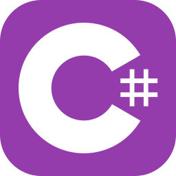
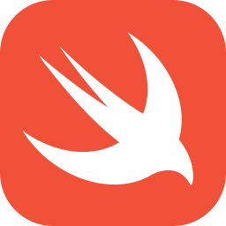
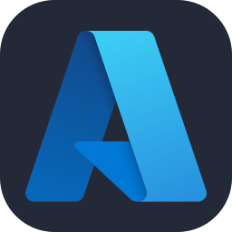

  
   
  
    Illustration © lililjiliijili.
    Source:
    <a href="https://x.com/lililjiliijili/status/941426073979404288">
      X Post
    </a>
  

---

  <a href="./README.md">🇨🇳 中文</a> |
  <a href="./README_EN.md">🇺🇸 English</a> | 
  <a href="./README_JP.md">🇯🇵 日本語</a> 

## 关于我

武汉大学人工智能专业本科生，2027 年 6 月毕业，毕业后直接工作。

实习过：字节跳动 · 哔哩哔哩 · 网易云音乐

### 项目

- [Orisumi](https://github.com/shenxianovo/Orisumi)：长期记录一个人的经历
- [me](https://github.com/shenxianovo/me)：写给自己和 AI Agent 的个人档案。想了解我的话，可以自己读，也可以丢给 Agent 读，从 ME.md 开始

### 常用技术

<table>
  <tr><td><b>语言</b></td><td>    </td></tr>
  <tr><td><b>框架</b></td><td>   </td></tr>
  <tr><td><b>数据与可观测</b></td><td>   </td></tr>
  <tr><td><b>部署与网络</b></td><td>    </td></tr>
  <tr><td><b>云</b></td><td>   </td></tr>
</table>

### Coding Profile

    

### 链接

- 个人网站：https://pwq.cat
- 服务状态：https://status.pwq.cat
- Catnet：https://id.pwq.cat
