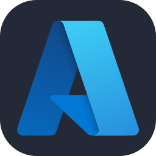

  
   
  
    Illustration © lililjiliijili.
    Source:
    <a href="https://x.com/lililjiliijili/status/941426073979404288">
      X Post
    </a>
  

---

  <a href="./README.md">🇨🇳 中文</a> |
  <a href="./README_EN.md">🇺🇸 English</a> | 
  <a href="./README_JP.md">🇯🇵 日本語</a> 

## プロフィール

武漢大学 人工知能専攻の学部生。2027 年 6 月卒業予定で、卒業後はそのまま就職します。

インターン：ByteDance · bilibili · NetEase Cloud Music

### プロジェクト

- [Orisumi](https://github.com/shenxianovo/Orisumi)：一人の経験を長く記録するプロジェクト
- [me](https://github.com/shenxianovo/me)：自分と AI Agent のための個人プロフィール。私に興味があれば、自分で読むか Agent に読ませてください。ME.md から始まります

### よく使う技術

<table>
  <tr><td><b>言語</b></td><td>    </td></tr>
  <tr><td><b>フレームワーク</b></td><td>   </td></tr>
  <tr><td><b>データ・可観測性</b></td><td>   </td></tr>
  <tr><td><b>デプロイ・ネットワーク</b></td><td>    </td></tr>
  <tr><td><b>クラウド</b></td><td>   </td></tr>
</table>

### コーディングプロフィール

    

### リンク

- ウェブサイト: https://pwq.cat
- サービスステータス: https://status.pwq.cat
- Catnet：https://id.pwq.cat
